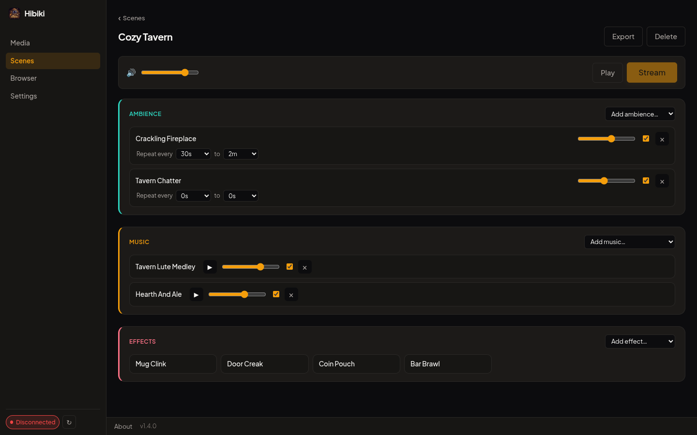
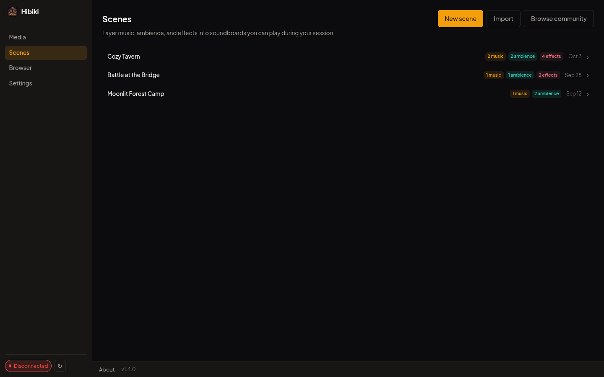
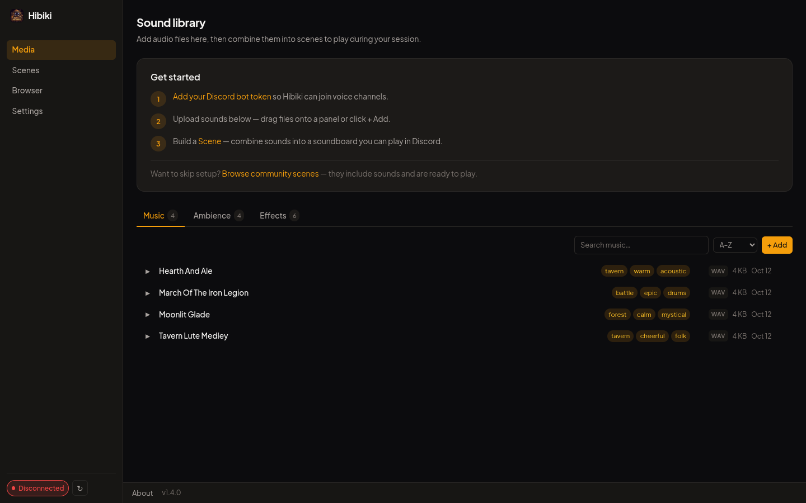
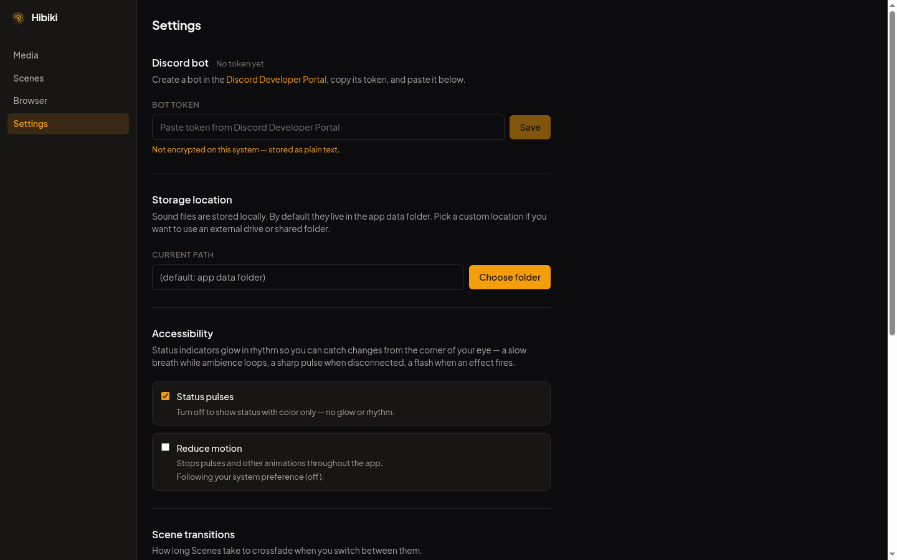

# Hibiki (響)


[](https://github.com/PhyberApex/hibiki/releases)
[](https://codecov.io/gh/PhyberApex/hibiki)
[](https://github.com/PhyberApex/hibiki/stargazers)

<p align="center"></p>



**Desktop audio companion for Discord** — play music, ambience, and sound effects in voice channels from an Electron app. Built with **Dungeons & Dragons** in mind (background music, ambient soundscapes, one-shot effects at the table) but works for any server.

- **Scenes** — Build soundboards with music tracks, ambience loops (with random interval repeats), and one-shot effects. Play an entire scene or individual tracks. Share scenes with the community or install from a [public registry](docs/scene-sharing.md). Grab ready-made [scene packs](https://github.com/PhyberApex/hibiki-scene-packs) with bundled CC0 audio to get started.
- **Browser** — Open any URL (YouTube, Spotify web, etc.) in a built-in browser tab and route its audio to Discord or to your own speakers, with its own tab volume under the master volume. Bookmark your favourite sites.
- **Media library** — Upload and manage your own sound files (music, effects, ambience). Import/export scenes as portable bundles.
- **Vision to Vibe** *(opt-in)* — Drop a battle map or mood-board image into a scene and get Music and Ambience suggestions from your own tagged library. Choose your Vision Provider in Settings: Claude (set a key via Settings or `HIBIKI_VISION_API_KEY`), or an OpenAI-compatible endpoint — OpenAI itself, a compatible gateway, or a local server like Ollama or LM Studio (key via Settings or `HIBIKI_VISION_OPENAI_API_KEY`, plus an editable Base URL and Model). Images are sent to the selected provider for analysis and never stored.
- **App-only control** — The bot has no slash or prefix commands; everything is driven from the desktop UI.

## 🤖 AI Disclaimer

> **Heads up!** Hibiki is developed with heavy use of AI coding tools. Issues and pull requests may be triaged, commented on, or authored by an AI agent, with a human maintainer reviewing before anything is merged. AI-assisted contributions are welcome too; see the [AI policy](CONTRIBUTING.md#ai-policy) for the ground rules.

## Screenshots

| Scenes | Sound library | Settings |
|---|---|---|
|  |  |  |

Regenerate these with `pnpm screenshots` (see [e2e/README.md](e2e/README.md)).

## Stack

| Part        | Tech                             |
|-------------|----------------------------------|
| Desktop app | Electron (main + renderer)       |
| Backend     | Node.js, Discord.js, TypeScript  |
| Frontend    | Vue 3, Pinia, Vue Router, Vite   |
| Audio       | discord.js voice, Web Audio API (AudioWorklet) |
| Persistence | JSON files (config, scenes, sounds on disk) |

## Requirements

- **Node.js** 24 (see [.nvmrc](.nvmrc)). Use `nvm use` to activate.
  The voice stack encodes Opus via `opusscript` (WASM), the same path in dev and packaged builds.
- **pnpm** — `corepack enable && pnpm install`
- **No ffmpeg** — audio processing uses the browser's Web Audio API.

## Setting up a Discord bot

A Discord bot token is only needed to play into Discord voice channels. To play through your computer's speakers, skip this section and choose **Play at the table** on the welcome screen.

### 1. Create an application and bot

1. Open the [Discord Developer Portal](https://discord.com/developers/applications).
2. Click **New Application**, name it (e.g. "Hibiki"), and create it.
3. Go to **Bot** → **Add Bot** and confirm.
4. Under **Token**, click **Reset Token** (or **View Token**), then **Copy**.
   Store it securely — you can set it in the app's **Settings** page or via the `DISCORD_TOKEN` env var.

### 2. Invite the bot to your server

1. Go to **OAuth2** → **URL Generator**.
2. Under **Scopes**, select **bot**.
3. Under **Bot Permissions**, select at least:
   **View Channels**, **Connect**, **Speak**, **Move Members**.
4. Copy the **Generated URL**, open it in a browser, choose your server, and authorize.

The bot will appear in your server's member list (offline until Hibiki is running).

## Download

Pre-built binaries for **macOS**, **Windows**, and **Linux** are available on the [Releases](https://github.com/PhyberApex/hibiki/releases) page.

| Platform | Format |
|----------|--------|
| macOS    | `.dmg`, `.zip` (Apple Silicon only) |
| Windows  | `.exe` (Squirrel installer), `.zip` (portable) |
| Linux    | `.deb`, `.zip` |

> **Windows note:** `Setup.exe` installs Hibiki to `%LocalAppData%\hibiki` and creates Start Menu/desktop shortcuts; the `.zip` is the portable, no-install build.

> **macOS note:** The app is not code-signed. macOS will quarantine it on first launch.
> After downloading, remove the quarantine flag before opening:
>
> ```bash
> xattr -cr /Applications/Hibiki.app
> ```
>
> Or right-click the app → **Open** → confirm in the dialog.

## FAQ

**Why not just use Discord's built-in soundboard?**
Discord's soundboard is for short clips, one at a time, with no looping and no layering. Hibiki is built for a whole session: a music track, several ambience loops, and one-shot effects all play at once, mixed into a single stream, and you can switch the entire scene with one click.

**Does Hibiki run on someone else's server?**
No. The bot runs inside the desktop app on your machine using a bot token you create. Nothing is hosted, nothing is metered, and your audio files never leave your computer (except as the voice stream Discord hears).

**Can I play YouTube or Spotify?**
Yes. The Browser tab opens any website inside Hibiki and, once you route the tab, streams its audio to the voice channel (or mixes it into your local output when you play at the table), following the master volume and its own tab volume. Please respect the terms of service of the site you are streaming from.

**Do my players need to install anything?**
No. Only the Game Master runs Hibiki. Players just sit in the voice channel.

**How does it compare to Kenku FM, Syrinscape, or Tabletop Audio?**
See the [comparison page](https://phyberapex.github.io/hibiki/compare).

**I used Kenku FM. What changes?**
The same bot token works, your files move into Hibiki's Sound Library, and playlists and soundboards become Scenes. The [Coming from Kenku FM](https://phyberapex.github.io/hibiki/kenku) page walks through it, including what to check when the bot joins but nobody hears audio.

## Quick start (from source)

```bash
git clone https://github.com/phyberapex/hibiki.git
cd hibiki
nvm use
corepack enable && pnpm install
cp .env.example .env   # optional: set DISCORD_TOKEN here, or configure it in Settings later
pnpm dev
```

This builds the backend and frontend, then launches the Electron app.
On the welcome screen pick a path:

- **Play at the table** — plays through this computer's speakers; no token needed.
- **Play in Discord** — set the bot token in **Settings** (or `DISCORD_TOKEN`), then use the sidebar to join a voice channel and start playing scenes or streaming browser audio.

## Scripts

All scripts are run from the **repo root**.

| Command | What it does |
|---------|-------------|
| `pnpm dev` | Build everything and launch the Electron app |
| `pnpm build` | Build backend (TypeScript) and frontend (Vite) without starting Electron |
| `pnpm dist` | Build and package the app for the current platform (uses Electron Forge) |
| `pnpm dist:mac` | Package for macOS (`.zip`) |
| `pnpm dist:win` | Package for Windows (Squirrel installer + `.zip`) |
| `pnpm dist:linux` | Package for Linux (`.deb` + `.zip`) |
| `pnpm lint` | Run ESLint across backend and frontend |
| `pnpm test` | Run backend (Jest) and frontend (Vitest) tests |
| `pnpm test:e2e` | Run E2E tests (requires a running Hibiki instance and Discord config — see below) |

## Project structure

```text
hibiki/
├── electron/               # Electron main process + preload scripts
│   ├── main.js             # Entry point, IPC handlers, protocol handler
│   └── preload.js          # Secure IPC bridge to renderer
├── src/                    # Backend (runs in Electron main process)
│   ├── discord/            # Discord.js client
│   ├── player/             # Playback, volume, voice connections
│   ├── sound/              # Sound library (music, effects, ambience)
│   ├── scenes/             # Scene store + import/export
│   ├── audio/              # Audio mixing (guild-specific managers)
│   └── bootstrap-embedded.ts  # Wires everything up, exposes IPC API
├── frontend/               # Vue 3 + Vite (renderer process)
│   └── src/
│       ├── api/            # IPC wrappers (player, sounds, scenes, config, browser)
│       ├── audio/          # Web Audio capture (AudioWorklet)
│       ├── stores/         # Pinia stores
│       └── views/          # Vue pages (Scenes, Browser, Media, Settings)
├── e2e/                    # End-to-end tests (Playwright + Vitest)
├── docs/                   # Jekyll docs site (GitHub Pages)
├── dist/                   # Compiled TypeScript backend (build output)
├── web-dist/               # Built frontend (Vite output)
├── out/                    # Packaged Electron apps (Electron Forge output)
├── forge.config.js         # Electron Forge configuration
└── package.json            # Single project package.json
```

## Storage

Hibiki stores data as JSON files:

- **`app-config.json`** — Discord token (when set in Settings), bookmarks, custom storage path, Vision to Vibe API key and toggle, the update check toggle and the last dismissed update.
- **`sound-tags.json`** — Free-form tags you add to your Music/Ambience files (used by Vision to Vibe matching).
- **`sound-durations.json`** — Each Music track's length, read from the file's header at upload (or the first time an older file is listed), so the playing track can show an elapsed / total timer.
- **`scenes.json`** — Scene definitions (soundboards with music, ambience, effects).
- **Sound files** — stored on disk under `music/`, `effects/`, `ambience/` directories.

When running as the Electron app, data lives in the platform's user data directory (e.g. `~/Library/Application Support/hibiki` on macOS). You can override paths via environment variables — see [.env.example](.env.example).

## Privacy

Hibiki has no account. It only contacts:

- **Discord** — once you set a bot token, to log the bot in and stream audio to voice channels.
- **GitHub** — once per launch, one request to the Releases API (`api.github.com`) to see whether a newer version exists. Nothing is downloaded or installed. Turn it off in **Settings → Updates**.
- **GitHub** — when you open the community scene registry, to fetch its index (`raw.githubusercontent.com`, cached for 24 hours).
- **Google Fonts** — to load the app's typeface.
- **Your Vision Provider** (Anthropic, or the Base URL you set) — only when Vision to Vibe is turned on and you analyze an image.
- **Websites you open** in the Browser tab.
- **The project's self-hosted Umami** (`analytics.phyberapex.de`) — only if you switch on **Usage Stats** in Settings. Off by default; anonymous counts of which features are used, no identifier stored. The full event list is on the [privacy page](https://phyberapex.github.io/hibiki/privacy).

## Code signing policy

<!-- Keep in sync with .github/release-notes/code-signing-policy.md, which is appended to every GitHub Release. -->

Hibiki's builds are currently **unsigned** on every platform. An application to the SignPath Foundation free code signing program was declined on 2026-10-21 because the project does not yet have enough public visibility (stars, forks, contributors, independent coverage). The maintainer will reapply once it does. Until then, this section documents how releases are produced so that a future signing identity can be trusted.

**Team roles.** Hibiki has one maintainer, [@PhyberApex](https://github.com/PhyberApex), who holds every role today:

- **Authors (committers):** [@PhyberApex](https://github.com/PhyberApex). Pull requests from other contributors, including AI-agent-authored ones (see the [AI Disclaimer](#-ai-disclaimer)), are merged only by the maintainer.
- **Reviewers:** [@PhyberApex](https://github.com/PhyberApex) reviews every pull request before it is merged.
- **Approvers:** [@PhyberApex](https://github.com/PhyberApex) approves every signing request.

**Policy.**

- Release binaries are built on GitHub Actions from the tagged release commit, never on a workstation.
- Once signing is in place, every signing request is approved manually by an approver.
- Every team member has multi-factor authentication turned on for GitHub.
- Only Hibiki's own binaries will be signed. Bundled upstream open-source binaries, such as the prebuilt `@snazzah/davey` native module, ship unsigned as their upstream projects publish them.
- What the app contacts over the network is listed under [Privacy](#privacy).

> **Windows note:** Windows SmartScreen shows "Windows protected your PC" for the unsigned installer. Click **More info**, then **Run anyway**. Once releases are signed, the warning still takes several releases to fade, because SmartScreen trusts a signature only after enough downloads under the same certificate have built up reputation.

## E2E tests (real Discord)

The `e2e` directory contains tests that connect to a real Discord server and drive the Hibiki API.

1. **Start Hibiki first** — `pnpm dev` — so the API is reachable.
2. Copy `.env.e2e.example` to `.env.e2e` and set **E2E_GUILD_ID**, **E2E_VOICE_CHANNEL_ID**.
3. Run: `pnpm test:e2e`.

See [e2e/README.md](e2e/README.md) for details on sidecar bot setup and optional config.

## Docs

- **Architecture** — [CONTEXT.md](CONTEXT.md) for the domain vocabulary, [agent-docs/adr/](agent-docs/adr/) for design decisions, [CLAUDE.md](CLAUDE.md) for development rules.
- **Docs website** — The [docs/](docs/) folder is a Jekyll site deployed via GitHub Pages. See [docs/README.md](docs/README.md).
- **Scene packs** — [hibiki-scene-packs](https://github.com/PhyberApex/hibiki-scene-packs) hosts ready-to-import `.hibiki.zip` scenes with bundled CC0 audio (tavern, forest, dungeon, battle, storm, crypt, high seas, market).

## Contributing

Contributions are welcome. See **[CONTRIBUTING.md](CONTRIBUTING.md)** for setup, running lint and tests, how to submit changes, and our [AI policy](CONTRIBUTING.md#ai-policy).

## License

[MIT](LICENSE)
